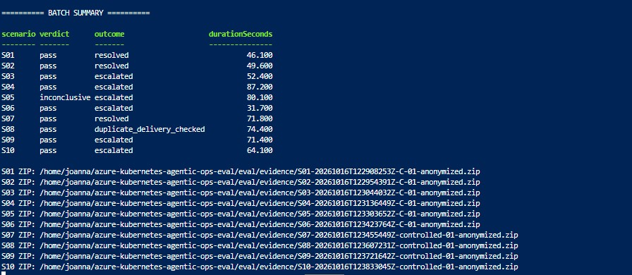

# S01-S10 batch evidence

Store anonymized ZIP archives from complete S01-S10 batch runs here.

Naming: `S01-S10-<UTC-run-id>-anonymized.zip`.

Each archive contains the collected scenario evidence and batch summary. Keep failed
and inconclusive trials with their original verdicts. Archive presence does not
imply that all ten scenarios passed. Raw working files stay under `.local/evidence/`.

The batch runner writes new combined archives here automatically. Individual
scenario archives remain directly under `eval/evidence/`.

## Recorded batch — 2026-10-16

Run `S01-S10-20261016T122908199Z`: nine scenarios passed; S05 was inconclusive.
This screenshot records that run and does not imply a ten-scenario pass.

